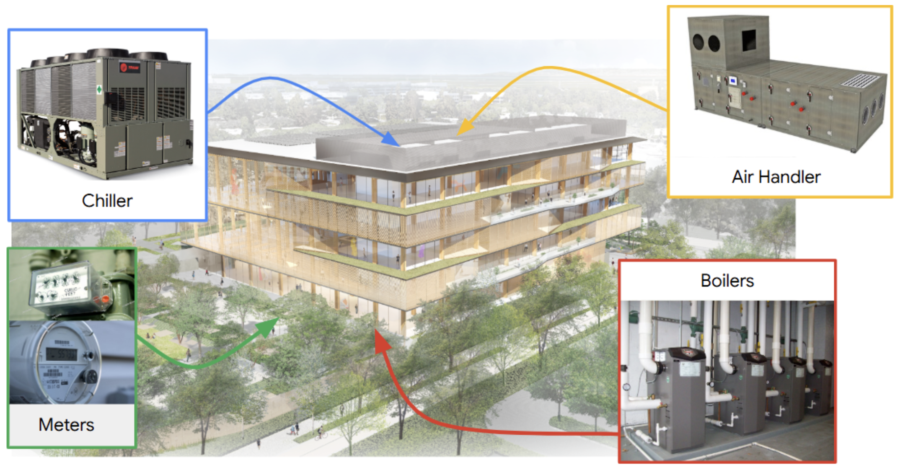
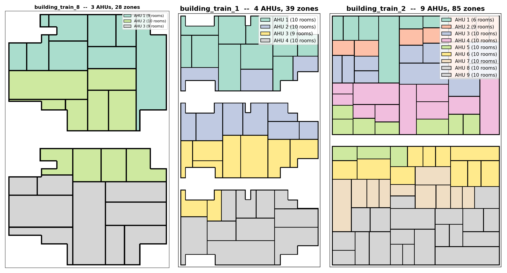
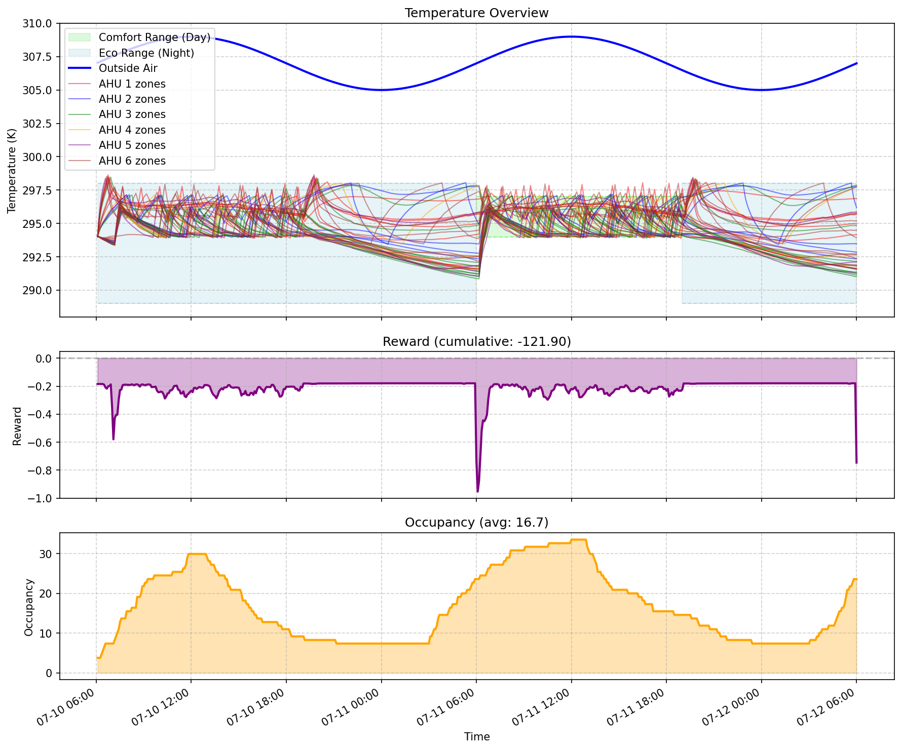

# Towards Foundation-Style Learning for Generalizable HVAC Control

一套policy，适用于各种布局和天气条件下的商业建筑暖通空调系统，在确保使用者舒适的同时，共同降低能源成本并减少碳排放。

## Overview: Learn one policy, not one controller

需要学习一个能够泛化到任意楼层平面布局、HVAC 系统拓扑和天气条件的统一策略
使其能够在不同建筑布局和天气条件下控制商业建筑的暖通空调系统（HVAC）。

该策略需要决定:

- 何时运行各个空气处理机组（Air Handler Unit, AHU）和热水泵(HWS)
- 设置设备的温度、压力和空气再循环比例等设定值
- 在不同区域之间分配空气

在维持室内人员舒适度的同时，联合最小化能源成本和碳排放。

> [!INFO]
> 控制策略必须根据运行时提供的建筑描述信息和实时传感器数据，自主推断出有效的控制方案。
> 每个控制时间步对应 5 分钟。一个完整的 Episode 持续 30 天，共包含 8,640 个时间步，且每个时间步都会参与评分。
> 在每个时间步，控制策略需要观测当前建筑状态，并同时输出以下两类动作：
>
> - 离散动作：为下面的设备输出开启或关闭指令,以决定哪些设备正在运行并对建筑进行空气调节。
>   - 每个空气处理机组（AHU）
>   - 中央热水系统（Hot Water System, HWS）
> - 连续设定值：
>   - 对于每个 AHU：设置送风温度（Supply-Air Temperature）、风管静压（Duct Static Pressure）以及空气再循环比例（Recirculation Fraction）。
>   - 对于 HWS：设置锅炉供水温度（Boiler Supply-Water Temperature）和水泵压差（Pump Differential Pressure）。
>   - 对于每个区域的 VAV（Variable Air Volume，变风量末端装置）：设置风阀开度（Damper Position）和再热阀开度（Reheat Valve Position）。

同一个策略将不经修改，直接部署到训练过程中从未遇到过的建筑上。
这些建筑可能在楼层数量、几何结构、房间布局、区域划分、设备数量以及气候条件等方面存在差异。
由于不同建筑的 AHU 和区域（Zone）数量不同，因此观测向量和动作向量的维度也会随建筑而变化。

这种混合型、可变维度的动作空间，再加上需要泛化到未见过的建筑这一要求，使得该问题相比标准的固定维度强化学习基准任务具有更高的难度。

---

## Building components: A coupled dynamical system

更改一台空气处理机组（AHU）的设定值会影响多个区域；某个区域内的人员活动会使整栋建筑的热负荷发生变化。

- AHU(Air Handler Units): 负责冷却和混合空气的中央系统，并通过风管进行输送。
  - 一台AHU最多可服务10个区域；
  - training buildings 内设有3至9台空气处理机组。

- VAV(VAV Boxes, 变风量箱): 各区域的终端单元。
  - policy 设定了每个箱体的风门（该区域的供风比例）和再热阀（用于加热空气的热水）。
  - 它们是唯一按区域控制的装置。

- HWS(Hot Water System): 一台中央锅炉和水泵向空气处理机组（AHU）盘管及分区终端供应热水。
  - policy 通过设定锅炉设定值和水泵压力来调节供热能力。

- Zone(Zones): 各房间均配备独立的温度传感器和使用时间表。
  - training buildings 共有28至85个区域，具体数量取决于其规模和布局。



商业建筑中主要的暖通空调设备:

- 冷水机和空气处理机负责调节和分配空气
- 锅炉和热水系统提供供暖
- 计量器则记录奖励带来的能量和碳排放
- policy 通过离散的开关指令和连续的设定点来驱动这些设备


`building_train_1`:

- three floors
- 39 zones
- 4 AHUs (serving 10, 10, 9, and 10 zones)



---

## Observation & action spaces: Building-specific by design

Observation and action spaces 主要是由区域数量和空气处理机组（AHU）的数量决定

### State

每个观测项的长度与建筑规模成正比（随着区域和空气处理机组的增加而增长）:

- Per zone：空气温度、当前制热和制冷设定值、风门位置、再热阀位置、风量设定值。
- Per AHU：送风温度、静压和风量（实测值和设定值）、新风量、制冷请求计数以及风机运行状态。
- HWS：出水温度（实际值和设定值）。
- Occupancy & schedule：建筑级人员占用人数，以及当前和即将到来的舒适模式标志。
- Weather：室外空气温度。
- Time：当前时间及星期几（以循环编码形式表示）。

此外，该策略还可选地使用静态平面图和空气处理机组与区域的映射关系，这些信息在运行时通过建筑元数据提供。

### Action Space

Action 是一种混合型、可变维度的字典。

对于拥有 `K` 台AHU和 `V` 个zones（每个zone配有一个VAV box）的建筑：

- _discrete_ 组件的形状为 `(K+1)`，即每台AHU对应一个开/关位，外加HWS；
- _continuous_ 组件的维度为 (3K+2+2V)：
  - 每台AHU有三个设定点（supply-air temperature(送风温度), static pressure(静压), recirculation(新风率)）
  - HWS有两个设定点（supply-water temperature(供水温度), differential pressure(压差)）
  - 每个VAV box有两个设定点（damper(风门), reheat valve(再热阀)），
  - 每个设定点均归一化为 `[-1,1]` 。

一台AHU向其管理的所有区域发送同一送风温度，因此风门和再热阀是唯一需要按区域决策的参数。

模拟器强制执行通风底限：运行中的AHU需保持最低static pressure，recirculation上限为70%，且每个damper保持至少10%的开启度。

这些形状差异很大，因为生成器采样了广泛的配置空间：

- 2至4层；
- 占地面积400至700英尺×300至500英尺；
- 复合布局；
- 30至60英尺的房间；
- 以及每个区域1至2名使用者。

> [!INFO] Example
> `building_train_1` 配备4台AHU和39个Zones，其离散操作为5位，连续操作为92个值。
> action space应从建筑元数据中读取索引布局，而非自行假设。

---

## Reward Function: A regret-based, three-way tradeoff

在每个步骤中，policy 都会获得三个相互竞争指标(comfort(舒适度), energy cost(能源开销), carbon emission(碳排放量))的加权和。

$$
r_t = \alpha_\text{comfort}\delta_t + \alpha_\text{energy}c_t + \alpha_\text{carbon}e_t
$$

- $\delta_t$: 舒适度 (comfort term)
  - 在有人活动的zones处于舒适带时等于0并随区间偏离舒适带而下降
  - 偏离舒适带5 K以内呈线性下降，之后呈二次函数形式下降，且无下限
  - 放弃舒适度绝非免费

- $c_t$: 能源开销 (electricity and gas)
- $e_t$: 碳排放量
  - 这两者都作为成本因素纳入计算

权重 $\alpha_{i}$ 由主办方设定，且对每份提交的方案均相同，且其总和为1：

$$
\alpha_\text{comfort} = 0.6,\ \alpha_\text{energy} = 0.2,\ \alpha_\text{carbon} = 0.2
$$

这使得舒适度成为主导因素，同时仍需为能耗和碳排放支付实质性成本，从而形成了核心的权衡关系。

- 激进的预调节能将舒适度维持在最佳水平附近，但会导致能耗和碳排放居高不下；
- 而关闭设备虽能消除能耗和碳排放，却会在各区域有人时显著降低舒适度。

由于舒适度仅在有人区域进行评分，因此该机制更倾向于采用前瞻性、基于占用状况的控制策略：
即在人员到达前预先调节空间环境，待其离开后则逐步调整至节能区间。



- Top：各区域温度与日间舒适区间（绿色）及宽松的夜间节能区间（蓝色）的对比，并标注了室外温度。
- Middle：每步奖励及其累计总额。
- Bottom：人员在场情况。

舒适度仅根据当前生效的区间进行评分，因此在有人在场时段，偏离该区间会受到惩罚，但在夜间则可在较宽的节能区间内有所波动。
奖励的下降与最严重的舒适度违规情况以及高能耗时段相吻合。

---

## The interface: Write a policy

参赛提交内容是一个 Kaggle Notebook:

- 需要继承Evaluation Gateway提供的Policy Base Class
- 将自己实现的策略类交给Inference Server。
- 对于每个评测场景，系统会使用 `building_meta_data` 和 `action_spec` 初始化你的策略类一次。
- 在每个时间步，Evaluation Gateway都会调用：`get_action(obs)`
- 不需要包含Scenario List，也不需要编写Rollout Loop。

完整的可运行版本位于 Kaggle 的“代码”标签页中的  中。

```python
from typing import Dict, Any
import numpy as np

from kaggle_evaluation import smart_buildings_inference_server

class TransferPolicy(smart_buildings_inference_server.Policy):
    def __init__(self, building_meta_data, action_spec):
        super().__init__(building_meta_data, action_spec)
        self.n_discrete = building_meta_data["n_discrete_action"]
        self.n_continuous = building_meta_data["n_continuous_action"]

    def get_action(self, obs: np.ndarray) -> Dict[str, Any]:
        return {
            "continuous_action": np.zeros(self.n_continuous, dtype=np.float32),
            "discrete_action": np.zeros(self.n_discrete, dtype=np.int32),
        }

smart_buildings_inference_server.SmartBuildingsInferenceServer(TransferPolicy).run()
```

---

## How to submit: From starter notebook to leaderboard

1. Copy Starter Notebook: 打开，找到 TransferPolicy Notebook 并复制一份。

2. Write your policy: 替换 `get_action` 方法中的控制逻辑。

   - 保留以下两个方法的函数签名：`__init__(building_meta_data, action_spec)`和`get_action(obs)`
   - 确保策略类继承自：`smart_buildings_inference_server.Policy`
   - 将模型权重保存为 Kaggle Dataset，并将该 Dataset 附加到 Notebook 中。然后在 `__init__` 方法中加载模型权重。

3. Test in the notebook: 直接运行 Notebook，会执行一个公开的示例场景。或者可以使用  中的两个脚本：
   - `evaluate.py`：运行本地评测。
   - `score_leaderboard.py`：计算排行榜评分。

4. Submit: 保存 Notebook 的一个版本，然后通过 提交。

> [!INFO] Guidelines
>
> 1. 每个场景都会重新初始化策略。
> 2. 运行时间限制：
>    - 每个场景的第一个时间步最多允许 15 分钟，用于加载模型等初始化操作。
>    - 后续每个时间步最多允许 60 秒。
>    - 整个提交必须在一次 Kaggle Session 内完成。
> 3. 确保动作在合法范围内。所有输出动作必须满足动作空间的上下界约束，超出范围的动作将被拒绝。
> 4. 确保每个动作都是有限数值。不允许输出 NaN。
> 5. 从建筑元数据中读取动作和观测的位置。不要硬编码（Hardcode）动作或观测向量中的索引。
> 6. 不得引用保留测试集中的建筑配置或天气数据。禁止访问或利用隐藏测试场景的配置及天气信息，否则将根据竞赛规则被取消参赛资格。

: 论文需要通过 OpenReview 单独提交

- 
- Final Round: 2027年1月15日

---

## Building Metadata

建筑元数据描述建筑的静态结构和控制配置，使同一个控制策略能够适应不同的建筑，而不依赖固定的输入输出维度。

1. Action Structure:包含离散动作和连续动作的数量，以及各控制变量在动作向量中的索引：
   - **Discrete Actions**：AHU 和 HWS 的开关控制。
   - **Continuous Actions**：
     - AHU：送风温度、风管静压、空气再循环比例。
     - HWS：锅炉供水温度、水泵压差。
     - VAV：各 Zone 的风阀开度和再热阀开度。

2. Observation Structure: 包含观测字段名称及其在观测向量中的索引，例如：
   - 各 Zone 的温度传感器位置。
   - 不同观测变量对应的字段名称。

3. Building Layout: 描述建筑的空间结构及 HVAC 设备连接关系
   - **Floor Plan**：楼层平面图。
   - **Zone Map**：区域划分及空间分布。
   - **Zone-to-AHU Assignment**：每个 Zone 对应的 AHU。
   - **Number of Floors**：建筑楼层数量。

4. Schedule & Comfort Targets: 提供建筑的运行时间表和温度控制目标
   - **Morning / Evening Start Hours**：早晚运行时间。
   - **Comfort Window**：工作时间的舒适温度范围。
   - **Eco Window**：无人时段的节能温度范围。
   - **Time Zone**：建筑所在时区。
   - **Holiday Calendar**：节假日安排。

5. Normalization: 提供 Observation 和 Action 的归一化参数，将不同单位和数值范围的变量映射到统一尺度，便于控制策略处理。

6. Why It Matters: Building Metadata 使策略能够：
   1. 根据建筑结构动态确定 Observation 和 Action 的维度及索引。
   2. 理解 Zone 与 AHU 之间的连接关系。
   3. 根据运行时间和舒适度要求调整控制行为。
   4. 在不同建筑之间复用同一套策略参数，实现跨建筑泛化（Cross-Building Generalization）。

> [!INFO]
> 策略可以表示为：$a_t=\pi_\theta(o_t,m)$
>
> - $o_t$：当前建筑的实时观测。
> - $m$：建筑元数据。
> - $\pi_\theta$：所有建筑共享的控制策略。
> - $a_t$：当前时间步的控制动作。

---

## Mean absolute error against zero

采用Mean Absolute Error against zero(MAE)作为评分指标，**分数越低越好**。

每个场景贡献其平均每步奖励，最终对所有场景的平均奖励计算与目标值 0 的绝对误差：

$$
\text{score}
=\frac{1}{|S|}\sum_{s\in S}|\bar r_s-0|
=-\frac{1}{|S|}\sum_{s\in S}\bar r_s
$$

- $S$：评测场景集合。
- $|S|$：场景总数。
- $\bar r_s$：场景 $s$ 的平均每步奖励，即8640个时间步的reward的平均值。
- 由于 $r_t\leq 0$，因此 $|\bar r_s|=-\bar r_s$。

## Evaluation Scenarios

1. Development Set
   - 6 栋公开建筑（Public Buildings）。
   - 5 个天气站（Weather Stations）。
   - 共 $6\times5=30$ 个场景。

2. Held-out Set
   - 6 栋未见过的建筑（Unseen Buildings）。
   - 5 个未见过的天气站（Unseen Weather Stations）。
   - 共 $6\times5=30$ 个场景。

`Building Generator`支持生成任意数量的额外建筑，供参赛者进行训练和验证。
